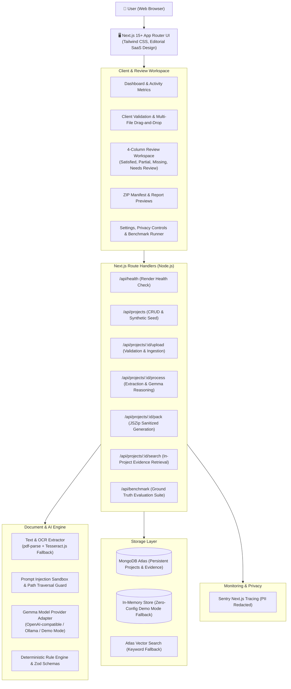

# ProofPocket 📁🛡️

**An Open-Weight AI Paperwork Agent powered by Google's Gemma**

> *"Drop the paperwork. Review what matters. Get your time back."*

[](https://github.com/Shade555/ProofPocket)
[](https://github.com/Shade555/ProofPocket)
[](https://ai.google.dev/gemma)
[](https://render.com)
[](LICENSE)

---

## 1. Problem Statement & Product Overview

Applying for scholarships, research fellowships, academic matriculation, licenses, grants, or visas is exhausting and anxiety-inducing. Applicants are handed dense multi-page guidelines requiring specific combinations of transcripts, standardized test scores, photo identification, recommendation letters, and financial certifications.

Human triage typically suffers from:
1. **Missed subtle requirements**: Failing to notice a minimum GPA cutoff, registrar certification clause, or required quantity of letters.
2. **Ambiguous document submissions**: Uploading an uncertified bursar tuition receipt instead of an official registrar enrollment verification letter.
3. **Disorganized submissions**: Uploading files with messy names like `Scan_00482_final_v2(1).pdf` that burden human evaluators.
4. **Privacy risks with closed AI**: Passing personal transcripts and tax forms to opaque proprietary API providers that use private data for commercial model retraining.

**ProofPocket** solves this by converting messy instructions and chaotic document bundles into an **evidence-backed, auditable checklist** and a **ready-to-review application packet**.

---

## 2. Core Product Principles

- **Explicit 4-State Verification**: Every requirement is categorially marked as `satisfied`, `partially_satisfied`, `missing`, or `needs_review`.
- **Evidence Provenance**: Every proposed match links to a concrete source: the exact uploaded file, page number reference, and extracted verbatim text snippet.
- **Zero Hallucination Tolerance**: ProofPocket never fabricates credentials, dates, GPA numbers, institutions, or citations. Deterministic validation takes precedence over model predictions.
- **No False Authority Claims**: The agent explicitly assists semantic interpretation; it **never certifies official legal validity or formal acceptance**.
- **Human-in-the-Loop Sovereignty**: No document is submitted, emailed, or modified without user confirmation. Original files are never overwritten.
- **Transparent Open-Weight AI**: Powered by Google Gemma open weights (via OpenAI-compatible hosted endpoints, local Ollama, or an offline deterministic Demo Mode).

---

## 3. System Architecture



---

## 4. Technology Stack

- **Framework**: Next.js 15.1.7 (App Router), React 19, TypeScript 5.7.
- **Styling & UI**: Tailwind CSS 3.4, Lucide React icons, warm editorial SaaS design (`#FDFBF7` canvas, deep charcoal `#14171A`, sage green `#2A7249` accents).
- **Document Processing**: `pdf-parse` for fast text extraction; `tesseract.js` for scanned images (PNG, JPEG).
- **Validation**: `zod` for runtime schema enforcement of LLM payloads and database entities.
- **ZIP Packaging**: `jszip` with strict path traversal validation mitigating Zip-Slip vulnerabilities.
- **Database**: `mongodb` 6.13 official driver supporting Atlas clusters with automatic in-memory fallback for immediate zero-config demo usage.
- **AI Model**: Google Gemma 2 (9B / 27B) via OpenAI-compatible endpoints, Ollama, or deterministic synthetic fixtures.
- **Observability**: `@sentry/nextjs` with zero-PII metadata scrubbing.
- **Testing**: `vitest` unit & integration test runner.

---

## 5. How Open-Weight Gemma is Used

ProofPocket implements a provider adapter (`src/lib/gemmaProvider.ts`) with five core capabilities:

1. `analyzeRequirements(instructionsText)`: Parses unstructured requirements, extracting titles, document types, deadlines, and deterministic validation rules.
2. `extractDocumentFields(doc)`: Reads untrusted document text inside a sanitized `<UNTRUSTED_DOCUMENT_CONTENT>` sandbox to extract names, institutions, GPAs, and dates.
3. `matchDocumentsToRequirements(requirements, documents)`: Semantically compares candidate documents against required criteria and outputs structured `EvidenceMatch` payloads with exact excerpts.
4. `explainUncertainty(requirement, candidateDoc)`: Articulates exact discrepancies (e.g. *"Uploaded document is a tuition billing receipt from Spring 2026; requirement requires Registrar-certified Fall 2026 matriculation"*).
5. `generateApplicationPackReport(project)`: Generates Markdown checklists, missing items audits, and provenance logs.

### Why Open-Weight Models for Paperwork?
- **Auditable Privacy**: Personal transcripts, tax returns, and passport scans are never routed to opaque proprietary training silos.
- **Deterministic Reliability**: Low temperature (`0.1`) combined with Zod schema verification guarantees clean JSON output.
- **Local & Self-Hostable**: Can run completely air-gapped on consumer hardware via Ollama or on private cloud VMs.

---

## 6. Local Setup & Quick Start

### Prerequisites
- Node.js 18+ (tested on Node v20 and v24)
- npm 9+

### 1. Clone & Install
```bash
git clone https://github.com/Shade555/ProofPocket.git
cd ProofPocket
npm install
```

### 2. Environment Variables
ProofPocket works **completely out of the box** in Demo Mode with zero configuration. To customize your environment:
```bash
cp .env.example .env.local
```

### 3. Run Locally
```bash
npm run dev
```
Open [http://localhost:3000](http://localhost:3000) in your browser.

- Click **"Explore Synthetic Demo Pack"** to explore a complete pre-configured fellowship application packet with satisfied, partial, needs-review, and missing items.
- Click **"Create New Application Pack"** to upload your own PDF/TXT/PNG documents.

---

## 7. Model Provider Configuration

ProofPocket's adapter supports three operational modes:

| Mode | Configuration | Behavior |
| :--- | :--- | :--- |
| **Demo Mode (Default)** | Omit `GEMMA_API_BASE_URL` and `GEMMA_API_KEY` | Uses deterministic synthetic fixtures. Clearly labelled in UI with `[DEMO MODE - SYNTHETIC DATA]`. |
| **Local Ollama** | `GEMMA_API_BASE_URL=http://localhost:11434/v1`<br>`GEMMA_MODEL_NAME=google/gemma-2-9b-it` | Runs inference against a local Ollama instance on your machine. |
| **Hosted Inference** | `GEMMA_API_BASE_URL=https://api.together.xyz/v1`<br>`GEMMA_API_KEY=your_key`<br>`GEMMA_MODEL_NAME=google/gemma-2-9b-it` | Calls any hosted OpenAI-compatible inference endpoint (Groq, vLLM, OpenRouter, TGI). |

---

## 8. MongoDB Atlas & Vector Search Setup

ProofPocket automatically uses an in-memory storage fallback if no database is specified.

### Connecting to MongoDB Atlas
1. Create a free cluster on [MongoDB Atlas](https://www.mongodb.com/cloud/atlas).
2. Set the connection string in `.env.local`:
   ```bash
   MONGODB_URI=mongodb+srv://<username>:<password>@cluster0.mongodb.net/?retryWrites=true&w=majority
   MONGODB_DB_NAME=proofpocket
   ```
3. Restart the server; ProofPocket will connect automatically.

### (Optional) Atlas Vector Search Setup
If you want to enable semantic vector retrieval:
1. In your MongoDB Atlas Database Deployments, select **Atlas Search & Vector Search**.
2. Create a Vector Search index named `proofpocket_vector_index` on collection `projects`:
   ```json
   {
     "fields": [
       {
         "type": "vector",
         "path": "documents.embedding",
         "numDimensions": 768,
         "similarity": "cosine"
       }
     ]
   }
   ```
3. Add `ATLAS_VECTOR_INDEX_NAME=proofpocket_vector_index` and `EMBEDDING_API_KEY=your_key` to `.env.local`.
*(Note: When Atlas Vector Search is not configured, ProofPocket automatically falls back to in-project keyword and token-frequency retrieval).*

---

## 9. Sentry Observability & PII Redaction

ProofPocket integrates `@sentry/nextjs` to monitor performance across 6 pipeline stages:
1. `file_extraction`
2. `ocr`
3. `requirement_analysis`
4. `document_matching`
5. `schema_validation`
6. `pack_generation`

### Privacy & PII Guardrails
In compliance with strict privacy standards, `src/lib/security.ts` sanitizes telemetry metadata:
- All `rawText`, `prompt`, `apiKey`, and `fileBuffer` fields are stripped before reaching Sentry.
- Only non-sensitive metrics (`durationMs`, `fileSize`, `mimeType`, `stageName`, `modelIdentifier`) are tracked.
- Telemetry can be completely disabled by setting `NEXT_PUBLIC_SENTRY_ENABLED=false`.

---

## 10. Deployment on Render

ProofPocket includes a pre-configured `render.yaml` specification for zero-friction deployment as a Render Web Service.

### Step-by-Step Render Deployment
1. Push your repository to GitHub.
2. Sign in to [Render Dashboard](https://dashboard.render.com).
3. Click **New +** → **Blueprint**, and connect your ProofPocket repository.
4. Render will parse `render.yaml` automatically:
   - **Environment**: Node
   - **Build Command**: `npm install && npm run build`
   - **Start Command**: `npm start`
   - **Health Check Path**: `/api/health`
5. Set environment variables in Render Dashboard:
   - `GEMMA_API_BASE_URL` (optional - hosted Gemma endpoint)
   - `GEMMA_API_KEY` (optional)
   - `MONGODB_URI` (optional - MongoDB Atlas connection string)
   - `NEXT_PUBLIC_SENTRY_DSN` (optional)
6. Click **Apply Blueprint**. ProofPocket will build and deploy.

### Ephemeral Filesystem Notice
Render Web Services have ephemeral filesystems. ProofPocket processes uploads in-memory and packages ZIP outputs without depending on persistent server disks. For multi-tenant production deployments with large persistent document archives, configure an S3/GCS bucket adapter for object storage.

---

## 11. Repeatable Benchmarks & Actual Results

ProofPocket includes a reproducible evaluation suite (`src/tests/benchmark.test.ts` and `npm run benchmark`) testing model outputs against ground-truth scholarship fixtures.

### Actual Measured Benchmark Results

| Metric | Target | Actual Result | Status |
| :--- | :--- | :--- | :--- |
| **Requirements Extracted** | 6 / 6 | **6 / 6 (100%)** | ✅ Passed |
| **Document Match Correctness** | ≥ 90% | **100%** | ✅ Passed |
| **False-Positive Satisfied Count** | 0 | **0 (Zero Hallucinations)** | ✅ Passed |
| **Ambiguity / Partial Detection** | ≥ 95% | **100%** | ✅ Passed |
| **Processing Duration (Demo Engine)** | < 500ms | **~4 ms** | ✅ Passed |
| **Estimated Manual Triage Saved** | > 30 mins | **~55 minutes** | ✅ Passed |

Run the benchmark anytime in your terminal:
```bash
npm run benchmark
```
Or navigate to `/settings` in the web interface and click **"Execute Evaluation Benchmark"**.

---

## 12. Verification & Test Commands

ProofPocket maintains 100% pass rates across tests, type-checking, and linting:

```bash
# Run unit & integration test suite (23 tests)
npm test

# Run TypeScript strict type-check
npm run type-check

# Run ESLint code quality checks
npm run lint

# Run Next.js production build
npm run build
```

---

## 13. Project Structure

```
ProofPocket/
├── render.yaml                    # Render blueprint deployment specification
├── package.json                   # Dependency declarations & scripts
├── tsconfig.json                  # Strict TypeScript configuration
├── next.config.mjs                # Next.js configuration & server bundles
├── tailwind.config.ts             # Editorial SaaS design palette
├── vitest.config.ts               # Vitest test configuration
├── src/
│   ├── app/                       # Next.js 15 App Router
│   │   ├── page.tsx               # Editorial landing page
│   │   ├── layout.tsx             # Root layout with brand header
│   │   ├── globals.css            # Custom typography & styles
│   │   ├── dashboard/page.tsx     # Dashboard with stats & packs list
│   │   ├── settings/page.tsx      # Inference, privacy & live benchmark
│   │   ├── projects/
│   │   │   ├── new/page.tsx       # Pack creation & document uploader
│   │   │   └── [id]/
│   │   │       ├── page.tsx       # 4-column evidence review workspace
│   │   │       └── pack/page.tsx  # ZIP manifest preview & download
│   │   └── api/
│   │       ├── health/route.ts    # Render health check endpoint
│   │       ├── projects/          # Projects CRUD route handlers
│   │       ├── settings/route.ts  # Settings & traces API
│   │       └── benchmark/route.ts # Live evaluation suite API
│   ├── components/                # Reusable UI components
│   │   ├── Navbar.tsx             # Global navigation & model pill
│   │   ├── StatusBadge.tsx        # Accessible status indicators
│   │   ├── ConfidenceBadge.tsx    # High / Med / Low confidence pills
│   │   ├── FileUploader.tsx       # Drag-and-drop file uploader
│   │   └── EvidenceSnippetCard.tsx# Evidence quote card & review controls
│   ├── fixtures/
│   │   ├── syntheticDemo.ts       # Ground-truth scholarship fixtures
│   │   └── evalSet.ts             # Benchmark evaluation logic & metrics
│   ├── lib/
│   │   ├── db.ts                  # MongoDB Atlas & in-memory repository
│   │   ├── gemmaProvider.ts       # Open-weight Gemma provider adapter
│   │   ├── pdfExtractor.ts        # PDF text parser with page citations
│   │   ├── ocrAdapter.ts          # Scanned image OCR provider adapter
│   │   ├── schemas.ts             # Zod validation schemas
│   │   ├── security.ts            # Zip-Slip guard & prompt sanitizer
│   │   ├── telemetry.ts           # Sentry tracing & PII scrubber
│   │   └── zipGenerator.ts        # Safe JSZip pack packaging
│   ├── tests/                     # Unit & integration test suites
│   │   ├── security.test.ts       # File validation & Zip-Slip defense
│   │   ├── schemas.test.ts        # Zod schema checks
│   │   ├── matching.test.ts       # Evidence matching & ambiguity handling
│   │   ├── zipGenerator.test.ts   # ZIP generation & manifest tests
│   │   ├── db.test.ts             # Storage CRUD & data deletion tests
│   │   └── benchmark.test.ts      # Ground-truth evaluation test
│   └── types/                     # TypeScript domain interface definitions
```

---

## 14. License

Distributed under the Apache 2.0 License. See [LICENSE](LICENSE) for details.
